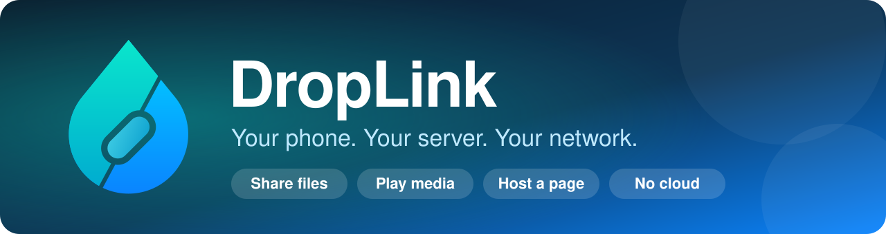
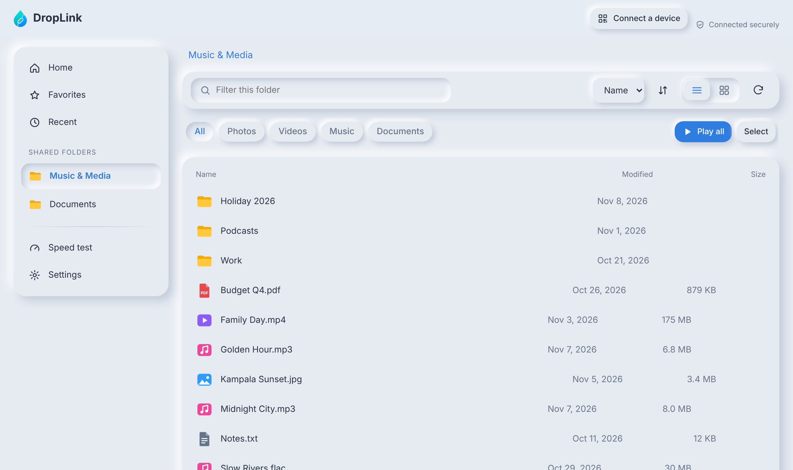
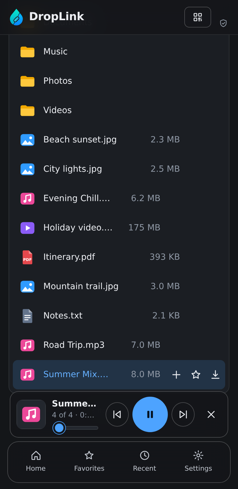
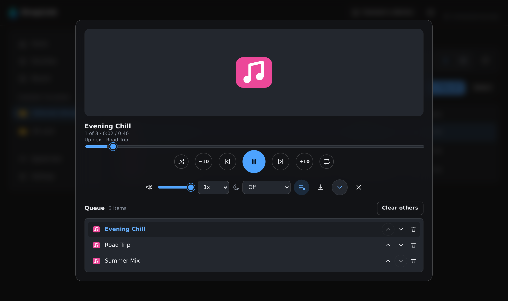
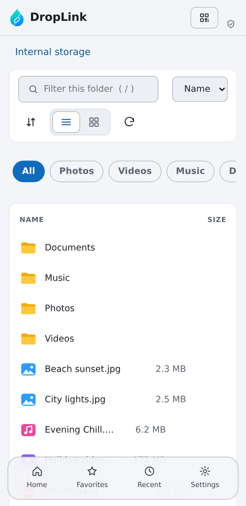
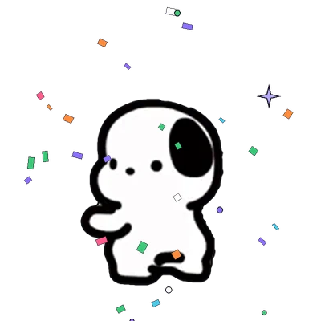
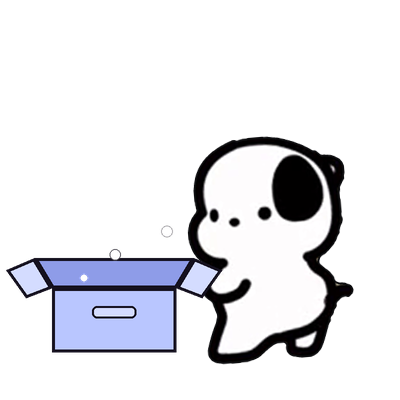
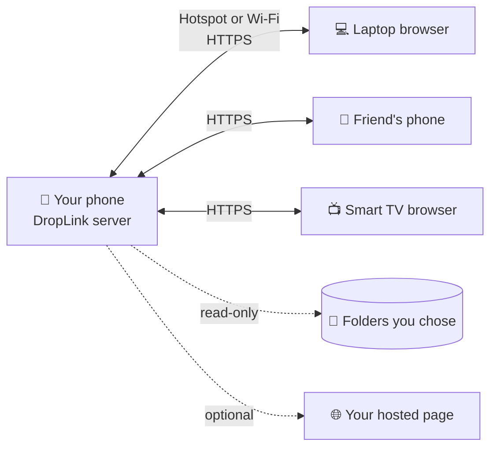

<p align="center">
  
</p>

<p align="center">
  
</p>

<p align="center">
  <a href="https://github.com/trebronwayne/DropLink/releases"></a>
  <a href="LICENSE"></a>
  
  
</p>

<h3 align="center">Turn your phone into a private server. Share files, play media and host a web page for anyone on your hotspot or Wi-Fi. No cloud, no accounts, no data plan.</h3>

<p align="center">
  <a href="#-quick-start">Quick start</a> ·
  <a href="#-features">Features</a> ·
  <a href="#-meet-aubree">Meet Aubree</a> ·
  <a href="#-host-a-page">Host a page</a> ·
  <a href="#-coming-soon">Coming soon</a> ·
  <a href="#-support-and-feedback">Support</a> ·
  <a href="PRIVACY.md">Privacy</a>
</p>

---

## See it

<table>
  <tr>
    <td width="66%"></td>
    <td width="34%"></td>
  </tr>
  <tr>
    <td></td>
    <td></td>
  </tr>
</table>

## 🐶 Meet Aubree

<table>
  <tr>
    <td width="30%" align="center"></td>
    <td>
      <b>Aubree is DropLink's mascot.</b> She greets a device that asks to connect, waits with it while you approve, and celebrates when it joins. She also turns up on empty folders, errors, lost connections and low-power warnings, so every screen has a friendly face and a clear next step.<br /><br />
      Aubree comes from <a href="https://github.com/trebronwayne/AubreeKit">AubreeKit</a>. In the app she is drawn with <code>aubree-compose</code>, and the web client uses the pictures in <a href="web/src/aubree"><code>web/src/aubree/</code></a>. People who prefer less motion see a still picture instead of the animation.
    </td>
  </tr>
</table>

<table>
  <tr>
    <td align="center" width="25%">
      <br />
      <b>Welcome</b><br />
      <sub>A device asks to connect</sub>
    </td>
    <td align="center" width="25%">
      <br />
      <b>Waiting</b><br />
      <sub>Waiting for you to approve</sub>
    </td>
    <td align="center" width="25%">
      <br />
      <b>Celebrating</b><br />
      <sub>A device just joined</sub>
    </td>
    <td align="center" width="25%">
      <br />
      <b>Offline</b><br />
      <sub>Can't reach the phone</sub>
    </td>
  </tr>
  <tr>
    <td align="center" width="25%">
      <br />
      <b>Empty</b><br />
      <sub>Nothing in this folder yet</sub>
    </td>
    <td align="center" width="25%">
      <br />
      <b>Oops</b><br />
      <sub>Something went wrong</sub>
    </td>
    <td align="center" width="25%">
      <br />
      <b>Sleepy</b><br />
      <sub>Battery Saver may pause hosting</sub>
    </td>
  </tr>
</table>

## ⚡ Quick start

1. **Install** the APK from the [Releases](https://github.com/trebronwayne/DropLink/releases) page and open DropLink.
2. **Share a folder:** *Files → Add shared folder*. Access is read-only and limited to what you pick.
3. **Start hosting** on the Home screen. Turn on your hotspot, or join the same Wi-Fi as the other devices.
4. **Connect:** scan the QR code on the Home screen with the other device's camera. DropLink opens in its browser with nothing to type.
5. **Approve** the request on your phone after checking the code matches. That's it.

> The first time, the browser shows a certificate warning. DropLink encrypts everything with its own certificate, so compare the fingerprint shown in the app, then continue.

## ✨ Features

| | |
|---|---|
| 📁 **Share folders** | Pick folders with Android's own picker. Read-only, nothing is copied or uploaded. |
| ⚡ **Fast browsing** | Folders open from a single storage query, are cached, and thumbnails load instead of full photos. |
| 🎵 **Music and video that keep playing** | A persistent player with queue (reorder and clear), shuffle, repeat, speed, sleep timer, resume where you left off and lock-screen controls. Keep browsing while it plays. |
| 📥 **Receive files** | Paired devices can send files to the phone, but only after you approve: **once**, or **always** for that device (or block it). They are saved in `Downloads/DropLink`. |
| 🔐 **Approval-based access** | New devices must be approved on the phone and can be revoked any time. Everything runs over HTTPS. |
| 📱 **Connect by QR** | One code opens DropLink. An optional small code lets a phone join your hotspot without typing the password. |
| 🌐 **Host a page** | Publish a website from a folder, with sign-in accounts and forms that send information to your phone. |
| 🧩 **Installable web client** | A clean Fluent-style design with light and dark themes, accent colours, favourites, recents, "continue where you left off" and an offline-friendly shell. |
| ♿ **Accessible by design** | Keyboard shortcuts, screen-reader labels, a skip link, focus that stays in pop-ups, text size, high contrast and reduce-motion settings. |
| 🔄 **Reconnects by itself** | If the address changes, scan the new QR code from the "Can't reach the phone" screen. |
| 🛡️ **Built to keep hosting** | Foreground service, wake and Wi-Fi locks, a self-checking watchdog, and a warning when Battery Saver would pause it. |
| 🚀 **Speed test** | Measure the link between a device and the phone. |
| 🐶 **Aubree, the DropLink mascot** | Aubree welcomes people who ask to connect, waits with them for approval, celebrates when a device joins, and shows up for empty screens, errors and low power. She comes from [AubreeKit](https://github.com/trebronwayne/AubreeKit). |

## 🌐 Host a page

Publish a real website straight from your phone, perfect for a class, a shop, an event or a family notice board.

- Choose a folder with an `index.html`, switch **Publish** on, share the address.
- Create **sign-in accounts**; anything in a folder named `private/` is shown only to signed-in visitors.
- Pages can **send information back to you** (contact forms, check-ins, orders) with a single `fetch` call.
- Choose whether **anyone on the network** can open it or only devices you approved.

```js
await fetch('/site-api/submit/contact', {
  method: 'POST',
  headers: { 'Content-Type': 'application/json' },
  body: JSON.stringify({ name, message })
})
```

Read the [Host a page guide](docs/HOST_PAGE.md) and try the ready-made [sample site](samples/login-site).

## 🔭 Coming soon

| | |
|---|---|
| 📺 **Live streaming** | Watch a video file as the phone plays it. |
| 📹 **Live camera** | Use the phone as a CCTV camera. |
| 🖥️ **Remote presentation** | Control slides on a big screen from the phone (PDF and image slides first; native PowerPoint rendering is a bigger project and comes later). |
| 📤 **Send and receive files** | Send to one, two or everyone connected. Recipients accept, or turn on auto-accept. People add their name on first visit. |
| 👥 **People** | See who is connected and send them messages, files and attachments. |
| 💬 **Feedback** | Visitors send feedback to you, and you reply. |
| 📋 **Richer device list** | More detail about every connected device. |

Follow progress in the [roadmap](docs/ROADMAP.md).

## 🔒 Privacy and security

- **No cloud.** No accounts with us, no ads, no analytics, no trackers. Your files never leave your devices.
- **Encrypted** with HTTPS between devices, **approval required** for every new device, **read-only** shared folders.
- Logs and crash reports stay on your phone unless you choose to email them.

Read the [Privacy Policy](PRIVACY.md) and the [security model](docs/SECURITY_MODEL.md).

## 🧭 How it works



## 🛠️ Build it yourself

You need Android Studio with Android SDK 36, JDK 17, and Node.js 20+ for the web client.

```bash
# 1. Web client (outputs into the app's assets)
cd web && npm install && npm run build && cd ..

# 2. Android app
gradle assembleDebug           # Gradle 8.11+, or open the folder in Android Studio and press Run
gradle assembleRelease         # signed, shrunk release build (see below)
```

**Release builds are shrunk with R8.** Code is minified and unused resources are removed, which makes the APK smaller. The rules live in [`app/proguard-rules.pro`](app/proguard-rules.pro). CI keeps each release's `mapping.txt` as a workflow artifact, so an obfuscated crash log can be turned back into real names (`retrace`). If a release build ever reports missing classes, add a `-dontwarn` line for them, or check `app/build/outputs/mapping/release/missing_rules.txt`.

| Part | Technology |
|---|---|
| App and server | Kotlin, Jetpack Compose, Ktor (CIO), ZXing |
| Web client | React, TypeScript, a hand-made Fluent-style design system |
| Releases | GitHub Actions (signed, semantic versioning) |

More in [`docs/`](docs): [architecture](docs/SYSTEM_ARCHITECTURE.md), [network protocol](docs/NETWORK_PROTOCOL.md), [service API](docs/SERVICE_API.md), [web client](docs/WEB_CLIENT.md), [performance](docs/PERFORMANCE.md) and [troubleshooting](docs/TROUBLESHOOTING.md).

## 💬 Support and feedback

- 🐞 **Found a bug or have an idea?** [Open an issue on GitHub](https://github.com/trebronwayne/DropLink/issues).
- ✉️ **Feedback, or something went wrong?** Email **[trebronwayne@gmail.com](mailto:trebronwayne@gmail.com)**. In the app, *Settings → Hosting activity → Email log* (or the *Problem report* card) prepares the message for you. Nothing is sent unless you press send.
- 🤝 **Want to help?** Pull requests are welcome. Please open an issue first for larger changes.

## 📄 License

Licensed under the [Apache License 2.0](LICENSE). See the [Privacy Policy](PRIVACY.md) for how information is handled.

<p align="center"><sub>Made for people who want to share on their own terms.</sub></p>
